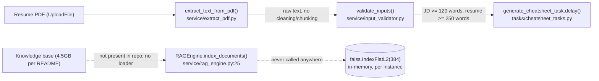
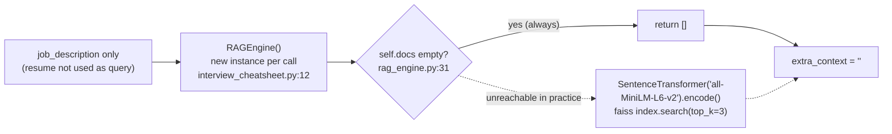
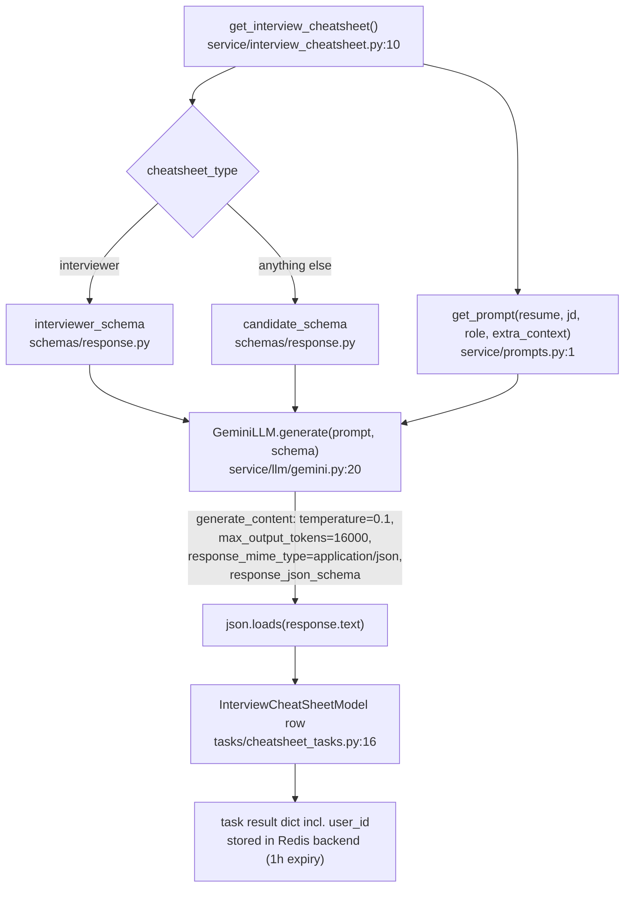
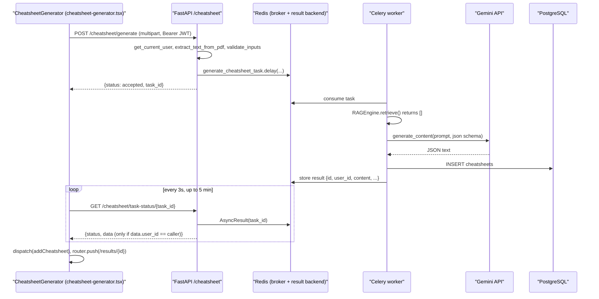
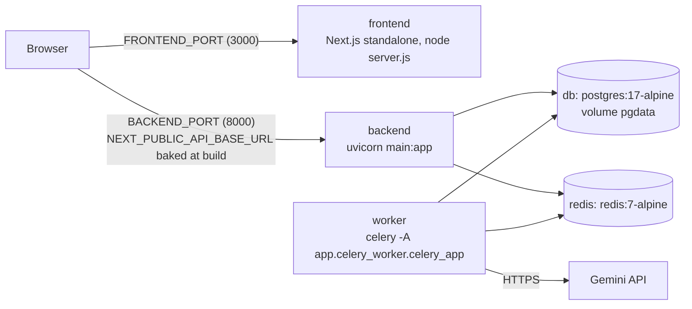

# Architecture (as implemented)

This document describes what the code in this repository **actually does today**. The top-level `README.md` describes an *intended* RAG architecture (LangChain chunking, ChromaDB, hybrid BM25 + dense retrieval). Most of that pipeline is not in the code. See [Intended vs actual](#intended-vs-actual).

## Overview

Job Fit AI takes a resume PDF and a job description and returns a structured JSON "cheatsheet" in one of two shapes:

- `candidate`: SWOT, skill match, concept refresh, predicted questions, company insights.
- `interviewer`: candidate overview, compatibility score, skills assessment, skill gaps, screening questions, recommendation.

How it works today:

1. **FastAPI** (`backend/app/run.py`) handles auth (JWT access tokens plus DB-backed refresh tokens), the upload, and history.
2. The upload is converted to text with **PyMuPDF**, checked for word count, and queued as a **Celery** task on **Redis**.
3. The worker builds a prompt and makes a single **Gemini** call (`google-genai`) with `response_json_schema` enforced. The result is stored in **PostgreSQL** as a JSON column.
4. The **Next.js + Redux** frontend polls the task status and then renders the dashboard from Redux state.

There is a "RAG" step, but it does nothing. `RAGEngine` creates a new, empty in-memory FAISS index on every request, and no code ever adds documents to it. So `retrieve()` always returns `[]`, and the `ADDITIONAL CONTEXT` section of the prompt is always empty. In practice the system is **prompt + structured-output generation, with no retrieval**.

## Diagrams

### Ingestion flow (actual)

There is no offline knowledge-base ingestion. The only "ingestion" is the per-request handling of the user's resume.



### Retrieval flow (actual)



### Generation flow



### Request lifecycle



### Deployment (docker compose)



Note that the frontend calls the backend **from the browser**: the API URL is baked in at build time (`docker-compose.yml:55-56`, `frontend/Dockerfile:10-12`). There is no server-side proxy.

## Key modules

| Path | Responsibility | Key functions/classes |
|---|---|---|
| `backend/main.py` | ASGI entrypoint | `app = create_app()` |
| `backend/app/run.py` | App factory, CORS, router mounting, `create_all` | `create_app()`, `CORS_ORIGINS` |
| `backend/app/core/config.py` | Requires `DATABASE_URL` | `DATABASE_URL` |
| `backend/app/core/middleware.py` | Request logging/timing to `api_logs.log` | `LoggingAndPerformanceMiddleware` |
| `backend/app/core/hashing.py` | bcrypt password hashing | `hash_password`, `verify_password` |
| `backend/app/db/session.py` | SQLAlchemy engine/session | `engine`, `SessionLocal`, `get_db`, `get_db_session` |
| `backend/app/db/models.py` | ORM tables | `UserModel`, `InterviewCheatSheetModel`, `RefreshTokenModel`, `PasswordResetTokenModel` |
| `backend/app/db/schemas.py` | Pydantic request models for auth | `UserSignupRequest`, `UserLoginRequest`, ... |
| `backend/app/routes/auth.py` | Signup/login/refresh/logout/reset/change password, JWT dependency | `get_current_user`, `create_access_token`, `create_refresh_token` |
| `backend/app/routes/cheatsheet.py` | Enqueue generation, poll status | `generate_cheatsheet`, `get_task_status` |
| `backend/app/routes/user.py` | Profile and cheatsheet history | `get_user_details`, `get_user_cheatsheets` |
| `backend/app/routes/health.py` | Liveness probe | `health_check` |
| `backend/app/celery_worker.py` | Celery app on Redis | `celery_app` |
| `backend/app/tasks/cheatsheet_tasks.py` | Background job: generate and persist | `generate_cheatsheet_task` |
| `backend/app/service/extract_pdf.py` | PDF to text (PyMuPDF) | `extract_text_from_pdf` |
| `backend/app/service/input_validator.py` | Minimum word counts | `validate_inputs`, `validate_word_count` |
| `backend/app/service/interview_cheatsheet.py` | Orchestrates retrieve, prompt, LLM | `get_interview_cheatsheet` |
| `backend/app/service/rag_engine.py` | Lazy SentenceTransformer + FAISS (always empty) | `RAGEngine.index_documents`, `RAGEngine.retrieve` |
| `backend/app/service/prompts.py` | Role-specific prompt template | `get_prompt` |
| `backend/app/service/llm/base.py`, `gemini.py` | LLM abstraction and Gemini implementation | `BaseLLM`, `GeminiLLM.generate` |
| `backend/app/schemas/response.py` | JSON schemas sent to Gemini | `candidate_schema`, `interviewer_schema` |
| `frontend/components/cheatsheet-generator.tsx` | Upload form, submit, poll | `CheatsheetGenerator`, `pollTask` |
| `frontend/app/results/[id]/page.tsx` | Picks the dashboard by `cheatsheet_type` from Redux | default page component |
| `frontend/components/results/*`, `components/interviewer/*` | Candidate and interviewer dashboards | `CandidateResultsPage`, `InterviewerResultsPage` |
| `frontend/components/layout.tsx`, `auth/login-form.tsx` | Load `/user/details` and `/user/cheatsheets` into Redux | `fetchUserDetails` (local) |
| `frontend/redux/*` | Store with `auth`, `user`, `cheatsheets` slices (not persisted) | `store`, `setCheatsheets`, `addCheatsheet` |
| `frontend/utils.ts` | API base URL and auth fetch helper | `apiBaseURL`, `fetchWithAuth` |
| `docker-compose.yml`, `start.py` | Local stack and free-port picker | `pick_port`, `main` |

## Intended vs actual

| README claim | Actual | Evidence |
|---|---|---|
| A 4.5GB knowledge base was collected, cleaned, and ingested (README:15-41) | No dataset, loader, cleaning, or ingestion script exists. `index_documents` has no callers. | `backend/app/service/rag_engine.py:25` (only definition) |
| LangChain `RecursiveCharacterTextSplitter`, 600/100 (README:43-62) | LangChain is not a dependency and no chunking exists | `backend/requirements.txt:1-29` |
| Embeddings stored in ChromaDB (README:77-87, 116) | No ChromaDB. A FAISS `IndexFlatL2(384)` in memory, recreated per request, never persisted | `backend/app/service/rag_engine.py:18-23`, `interview_cheatsheet.py:12` |
| Local embedding model (README:64-75) | `all-MiniLM-L6-v2` is coded, but it is never loaded because `retrieve` returns early on an empty index. torch is installed for nothing. | `rag_engine.py:14-15`, `rag_engine.py:31-33`, `backend/Dockerfile:10` |
| Resume and JD turned into queries (README:102-108) | Only the raw JD string is used as the query. The resume is not used, and there is no skill extraction. | `interview_cheatsheet.py:13` |
| Hybrid dense + sparse (BM25) retrieval with fusion (README:110-148) | No sparse retrieval and no fusion. Dense search only, and it is unreachable. | `rag_engine.py:30-43` |
| Context injection; the model is told to use only the supplied info (README:165-171) | `ADDITIONAL CONTEXT` is always empty, and the prompt contains no grounding/"use only" instruction | `service/prompts.py:13-24`, `interview_cheatsheet.py:14` |
| JSON schema enforcement and validation (README:173-186) | Gemini's native `response_json_schema` is used. There is no server-side validation after `json.loads`. | `service/llm/gemini.py:24-31` |
| "Company Insights" from company data (README:4, 201) | No company data source. The LLM produces it from the JD alone. | `schemas/response.py:167` |
| LLM provider not specified | Hard-wired to Gemini (`GEMINI_MODEL`, default `gemini-2.5-flash`) | `service/llm/gemini.py:18` |
| Stack list omits a queue (README:219-227) | Celery + Redis run generation asynchronously | `celery_worker.py:9-16`, `routes/cheatsheet.py:28` |

Other gaps worth knowing:

- The two layers default to different types. The backend defaults `cheatsheet_type` to `"interviewer"` (`routes/cheatsheet.py:19`), while the frontend defaults to `"candidate"` (`cheatsheet-generator.tsx:28`). A value other than these two raises `ValueError` in `get_prompt` (`prompts.py:11`). That error is caught and returned as `None`, so the task fails (`cheatsheet_tasks.py:11-13`).
- There are no migrations. Schema comes from `Base.metadata.create_all`, which runs twice: once in `init_db()` (`db/__init__.py:5`) and once in `run.py:38`.
- `frontend/constant/api.ts:5,26` hard-codes `http://localhost:8000` and calls `/user/detail` (singular). Nothing imports it; the live code is in `components/layout.tsx:19,35`.
- `/results/[id]` reads only from Redux (`app/results/[id]/page.tsx:20-21`), and the store is not persisted (`redux/store.ts:6-12`). Results survive a reload only because `layout.tsx` refetches `/user/cheatsheets`. There is no GET-by-id endpoint.
- `backend/dev.db` (SQLite) is committed, but the app does not use it (`core/config.py:6-8` requires `DATABASE_URL`).

## Data model

**PostgreSQL** (`backend/app/db/models.py`):

| Table | Columns | Relations |
|---|---|---|
| `users` (L11) | `id`, `name`, `email` (unique), `password` (bcrypt hash), `bio`, `location`, `job_title` | 1-N to the three tables below, cascade delete |
| `cheatsheets` (L42) | `id`, `resume_text`, `job_description`, `generated_at`, `content` (JSON, the LLM output), `cheatsheet_type`, `filename` | `user_id` FK to `users.id`, `ON DELETE CASCADE` |
| `refresh_tokens` (L57) | `id`, `token_hash`, `revoked`, `expires_at`, `created_at` | `user_id` FK |
| `password_reset_tokens` (L70) | `id`, `token_hash`, `used`, `expires_at`, `created_at` | `user_id` FK |

**Chroma collections:** none. ChromaDB is not used. The only vector store is the transient, always-empty FAISS index in `RAGEngine` (`rag_engine.py:22`).

**Redis:** Celery broker and result backend. Task results (including `user_id`, which `get_task_status` checks for ownership) expire after 3600 s (`celery_worker.py:16`, `routes/cheatsheet.py:58`).

## Running locally

Prerequisites: Docker with Compose, Python 3 (only needed for `start.py`), and a Gemini API key.

```bash
cp backend/.env.example backend/.env    # set SECRET_KEY and GEMINI_API_KEY (ALGORITHM=HS256)
python start.py                         # picks free ports, writes ./.env, runs `docker compose up -d --build`
python start.py --down                  # stop the stack
```

- `start.py` probes for free ports, starting from 3000/8000/5432, and saves its picks to the root `.env` (`start.py:13-17,60-77`). It then prints the frontend URL, the API URL (Swagger at `/docs`), and the Postgres address (user/password `jobprep`/`jobprep`).
- Compose starts five services: `db`, `redis`, `backend`, `worker`, and `frontend` (`docker-compose.yml`). `DATABASE_URL`, `REDIS_URL`, and `CORS_ORIGINS` are injected by compose. `backend/.env` provides the secrets.
- You can also run `docker compose up -d --build` directly; ports then default to 3000/8000/5432.
- Without Docker, start Postgres and Redis yourself, then set `DATABASE_URL`/`REDIS_URL` in `backend/.env` (see `.env.example`). Run these from `backend/`:
  - `uvicorn main:app --reload`
  - `celery -A app.celery_worker.celery_app worker --loglevel=info`

  Run this from `frontend/`:
  - `npm ci && npm run dev`, with `NEXT_PUBLIC_API_BASE_URL` set (default `http://localhost:8000`, `frontend/utils.ts:12`)
- Health check: `GET /health/`. A GitHub Action pings the Render deployment every 5 minutes (`.github/workflows/ping-health.yml`).
